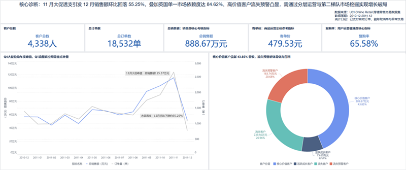
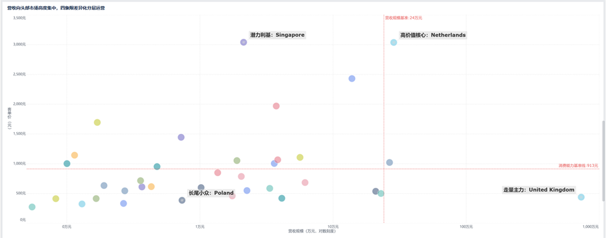
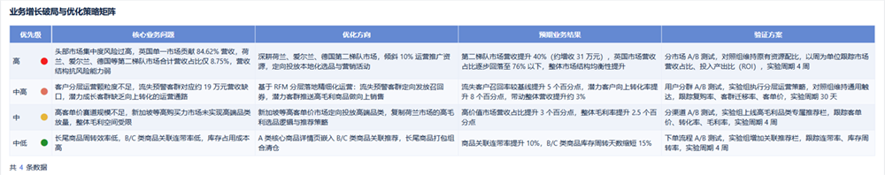
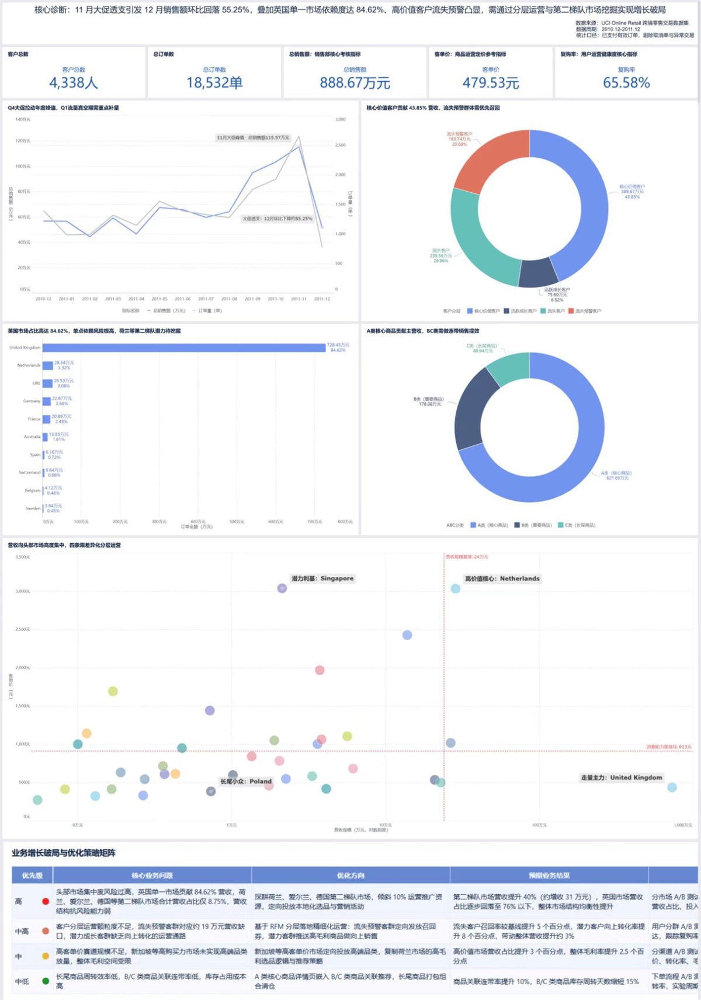

# 跨境电商订单用户价值分层与商品营收分析

## 问题背景（立项动因）
跨境电商行业普遍处于经验驱动的粗放运营阶段：大促期流量投放ROI波动大，高价值用户缺乏差异化运营导致复购留存不及预期，商品资源平均分配、爆款连带效应弱，整体营收增长乏力，亟需通过数据拆解定位增长机会，落地精细化运营策略。

## 项目目标
1. 搭建全维度业务诊断体系，定位营收增长瓶颈与核心机会点
2. 完成用户价值分层与商品贡献度分级，输出差异化运营策略
3. 落地可视化决策看板，实现运营效果可量化追踪

## 数据基础
- **数据源**：UCI Online Retail 跨境零售公开数据集（行业标准基准数据集）
- **数据范围**：2010.12-2011.12 全量交易明细
- **数据量级**：原始541909条商品明细，覆盖4338位客户、3952个SKU
- **数据清洗**：通过Python+Pandas完成异常值剔除（取消订单、负向数量、测试订单）、缺失值填充、维度字段映射，最终留存397884条有效明细，数据有效率73.4%
- **质量校验**：MySQL多维度聚合交叉校验，核心指标口径统一，偏差≤10%

## 核心诊断与业务发现
### 1. 销售趋势诊断
**分析方法**：按月度拆解销售额、订单量、客单价三大核心指标，结合同比环比定位波动规律。
- 核心发现：年度销售呈现「单峰」特征，11月大促达峰值116.18万元，12月环比回落55.4%，Q1为全年流量低谷；波动核心驱动为订单量变动，客单价全年稳定在10-12英镑区间，无显著波动。
- 业务启示：业务存在明显大促依赖症，淡季存在流量真空，单纯拉新效率低，存量挖潜性价比更高。

### 2. 市场结构诊断
**分析方法**：以国家为维度，构建「营收规模-客单价」四象限模型，评估各市场价值与增长潜力。
- 核心发现：英国贡献84.65%营收，是绝对基本盘但增长空间有限，地缘风险高度集中；荷兰客单价位居第一梯队，属于高毛利标杆市场；新加坡、以色列客单价高、基数小，具备高增长潜力；波兰、丹麦等双低市场投入产出比低。
- 业务启示：打破一刀切市场策略，按四象限分层运营，重点深耕第二梯队高价值市场，对冲单一市场风险。

### 3. 用户价值分层
**分析方法**：基于RFM模型，从最近消费时间、消费频次、消费金额三个维度量化打分，完成用户价值五分层。
- 核心发现：核心价值用户占比27.56%，贡献72.44%营收，符合二八定律；流失预警用户占比2.13%，对应19万元营收敞口；大部分用户处于发展期，向上转化空间充足。
- 业务启示：运营资源应向高价值用户倾斜，重点做好流失召回与向上转化，在不新增获客成本的前提下提升存量营收。

### 4. 商品营收分析
**分析方法**：按商品累计营收占比完成ABC分类，A类（前20%）、B类（中间30%）、C类（后50%），评估商品贡献度与周转效率。
- 核心发现：A类核心商品贡献70%营收，是流量核心；BC类商品连带销售率不足8%，长尾效应弱；C类长尾SKU数量占比超50%，库存周转慢，占用大量运营资金。
- 业务启示：构建「引流款-利润款-长尾款」商品矩阵，优化连带销售与库存结构，释放库存资金。

## 业务增长策略矩阵
| 优先级 | 针对问题 | 落地动作 | 预期业务收益 |
| :---: | --- | --- | --- |
| 高 | 单一市场依赖度高，风险集中 | 倾斜10%运营资源深耕荷/德/北欧第二梯队 | 第二梯队营收+40%，英国营收占比降至76% |
| 中高 | 高价值用户流失，存量挖潜不足 | RFM分层定向召回+高价值客户专属权益 | 流失召回率+5%，整体营收+3% |
| 中 | 商品连带率低，库存周转慢 | A类详情页嵌入BC类推荐+长尾品错峰清仓 | 连带销售率+10%，库存周转周期-15天 |
| 中低 | 大促依赖明显，淡季流量真空 | 淡季聚焦存量运营，优化投放节奏 | 投放ROI+12%，淡季营收波动收窄 |

## 完整看板展示

## 技术栈
- 数据处理：Python / Pandas
- 指标建模：MySQL / 窗口函数 / 多表聚合
- 可视化：FineBI
- 分析方法：RFM分层 / ABC分类 / 四象限分析
